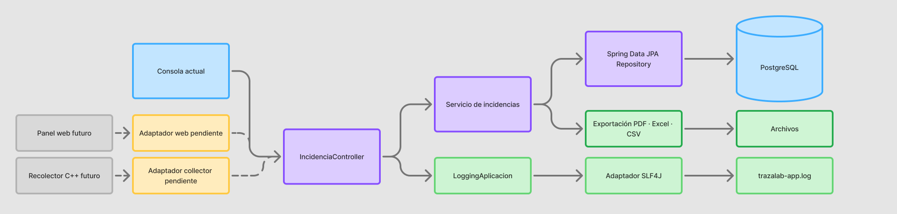

# Arquitectura de TrazaLab



## Criterio de diseño

La consola actual es un adaptador de entrada y salida; no contiene las reglas del sistema ni accede directamente a PostgreSQL. Los casos de uso se coordinan en el controlador de aplicación y el servicio. Los repositorios aíslan el acceso a datos. Así, la futura interfaz web y el recolector C++ podrán conectarse a los mismos casos de uso sin convertir la consola en el centro de la arquitectura.

## Flujo implementado

```text
Consola
  → DTO
  → controlador de aplicación
  → servicio / reglas / transacción
  → repository (Spring Data JPA, capa DAO)
  → Hibernate / JPA
  → PostgreSQL
```

Para registrar una incidencia, `ConsolaPersistencia` crea un `RegistroIncidenciaDto`; `IncidenciaController` valida y coordina; `RegistroIncidenciaPersistenteServicio` aplica las reglas; `IncidenciaJpaRepositorio` escribe la entidad asociada con usuario y computadora. La respuesta vuelve como DTO a la consola. Las consultas de lista e historial usan el mismo camino hacia los repositorios.

El controlador registra las acciones mediante el contrato `LoggingAplicacion`, sin conocer SLF4J, Logback ni el destino del archivo. `Slf4jLoggingAplicacion` es el adaptador actual y `logback-spring.xml` envía sus eventos `APP_EVENT` a `logs/trazalab-app.log`, aparte de los mensajes técnicos de Spring Boot. Los éxitos se registran como `INFO`, los rechazos de validación como `WARN` y los errores técnicos como `ERROR`. Si cambia el destino o proveedor, se sustituye el adaptador o su configuración sin modificar los casos de uso.

`IncidenciaController` es actualmente un controlador de aplicación, no HTTP. Los controladores MVC/REST pertenecerán al adaptador `web` cuando se implemente la página. Las entidades JPA se mantienen en `model` para reflejar el alcance actual; si el dominio crece, se podrán separar modelos de dominio y entidades persistentes sin cambiar los DTO de interfaz.

## Distribución de módulos

```text
com.utp.trazalab
├── app                    Arranque y carga inicial persistida de demostración
├── config                 Configuración transversal de Spring
├── console                Adaptador actual de consola
├── controller             Coordinación de casos de uso
├── database               Convertidores y detalles técnicos JPA
│   └── converter
├── dto                    Contratos de entrada y salida entre adaptadores y casos de uso
├── export                 Exportación de incidencias
│   ├── csv                Generador CSV UTF-8
│   ├── excel              Libro XLSX con filtros y formato
│   └── pdf                Reporte A4 apaisado y paginado
├── integration            Adaptadores externos
│   └── collector          Reservado para recibir datos de la app C++
├── logging                Contrato LoggingAplicacion y adaptador actual SLF4J
├── model                  Entidades y estados del sistema
├── repository             Repositorios Spring Data JPA; capa DAO
├── service                Reglas de negocio y transacciones
├── web                    Reservado para la futura interfaz web
└── TrazalabApplication.java
```

`src/test/java/com/utp/trazalab/integration` contiene pruebas de integración, separadas del código de producción. `database/` en la raíz del proyecto conserva el `compose.yaml`, el esquema SQL y los comandos de operación; el paquete Java `database` contiene solo integración de persistencia propia de la aplicación.

## Límites entre capas

| Módulo | Responsabilidad | Estado |
|---|---|---|
| `console` | Capturar opciones y presentar resultados | Implementado |
| `controller` | Coordinar entrada DTO, validación y caso de uso | Implementado para consola |
| `dto` | Transportar datos entre interfaz y lógica | Implementado para incidencias e historial |
| `service` | Validaciones de negocio y transacciones | Implementado para el flujo de incidencias |
| `repository` | Consultar y guardar entidades con Spring Data JPA; corresponde a DAO | Implementado |
| `database` | Convertidores de estados para el esquema PostgreSQL | Implementado |
| `logging` | Eventos de operaciones exitosas, rechazadas o fallidas mediante `LoggingAplicacion` | Implementado; salida actual a archivo |
| `export` | Producir reportes PDF, Excel y CSV desde datos consultados por los casos de uso | Implementado para el listado de incidencias |
| `web` | Adaptador HTTP/panel para reutilizar casos de uso | Reservado; pendiente |
| `integration.collector` | Validar y recibir el contrato de la aplicación C++ | Reservado; protocolo pendiente |

Los módulos `web` e `integration.collector` son extensiones futuras. La recepción desde C++ deberá definir formato, autenticación, validación, reintentos y control de duplicados antes de implementarse. Los exportadores reciben DTO de aplicación y no consultan tablas directamente.

## Persistencia

- PostgreSQL es el almacenamiento de ejecución; no hay repositorio en memoria.
- `repository` contiene interfaces Spring Data JPA y representa la capa DAO solicitada.
- Hibernate es el proveedor ORM de JPA.
- El esquema fuente es [`../database/01_trazalab_schema.sql`](../database/01_trazalab_schema.sql), aplicado por Docker al crear el volumen inicial.
- `spring.jpa.hibernate.ddl-auto=validate` compara el mapeo con el esquema y no lo crea ni modifica.
- `.env` contiene credenciales locales y está excluido de Git.
- Flyway no está instalado; puede añadirse cuando se requiera migración versionada del esquema.

`spring.main.web-application-type=none` mantiene el arranque actual en consola. El perfil `persistencia` usa las variables de entorno para conectar con PostgreSQL.

## Trazabilidad y evidencia

| Elemento | Correspondencia | Estado |
|---|---|---|
| RF-05 | Registro de incidencia vinculada a computadora y usuario | Implementado con PostgreSQL |
| RF-01 / RF-02 | Ficha e historial de incidencias por QR | Implementado; historial de componentes pendiente |
| `ConsolaPersistencia` | Interfaz actual | Implementada |
| `IncidenciaController` | Controlador de aplicación que recibe DTO | Implementado; no HTTP |
| `RegistroIncidenciaPersistenteServicio` | Reglas y transacción | Implementado |
| `*JpaRepositorio` | Consultas y escritura / capa DAO | Implementado |
| `RegistroIncidenciaJpaTest` | Persistencia y validación con PostgreSQL temporal | Prueba existente; verificar resultado Maven al presentar |
| Exportación del listado de incidencias | `ExportacionIncidenciasController` y generadores por formato | Implementada; conservar los archivos de salida como evidencia |
| Panel web y aplicación C++ | Adaptadores futuros sobre los casos de uso | Pendientes; el protocolo de integración no está definido |

La matriz detallada está en [`Matriz Trazabilidad.md`](Matriz%20Trazabilidad.md). El diagrama unificado está en [`TrazaLab_Arquitectura_Trazabilidad.drawio`](TrazaLab_Arquitectura_Trazabilidad.drawio).
