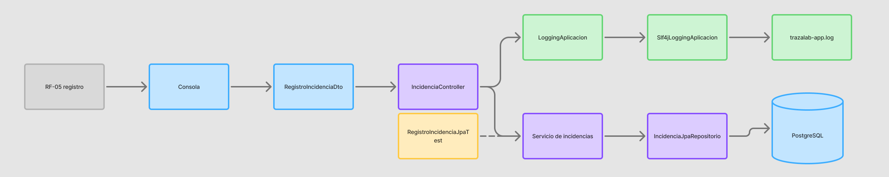
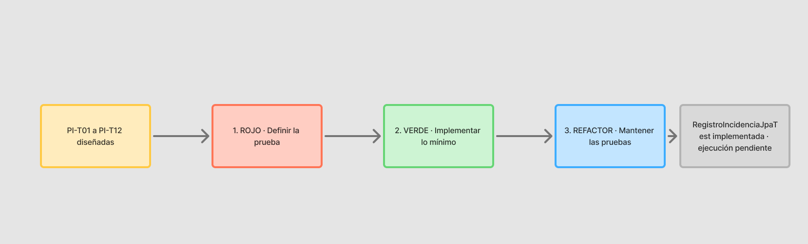

# Matriz de trazabilidad de TrazaLab

La referencia académica actualizada es [S10_Matriz_Trazabilidad_y_Transferencia.xlsx](S10_Matriz_Trazabilidad_y_Transferencia.xlsx), copia de `APF03/Matriz de Transferencia y Trazabilidad.xlsx`. Allí cada requisito enlaza entrada, código, persistencia, prueba, evidencia y estado. Las rutas APF son relativas a la carpeta `ProyectoFinal`.

## Estado por requisito

| Requisito | Correspondencia verificable | Estado |
|---|---|---|
| RF-01, historial técnico | `ConsolaPersistencia.consultarHistorial` → `IncidenciaController.consultarHistorialComputadora` → `RegistroIncidenciaPersistenteServicio.consultarHistorialComputadora` → `IncidenciaJpaRepositorio.findAllByComputadora_IdOrderByFechaRegistroAsc`. Presenta ficha e incidencias. | Parcial: mantenimientos, fallas clasificadas y componentes pendientes. |
| RF-02, identificación por QR | La consulta busca el código introducido como texto mediante `ComputadoraJpaRepositorio.findByCodigoQrIgnoreCase`. | Parcial: lector físico e interfaz P02 pendientes. |
| RF-03, mantenimiento | Tablas `mantenimiento` y `mantenimiento_componente` del esquema SQL; no hay servicio ni repositorio JPA de mantenimiento. | Diseñado. |
| RF-04, disponibilidad | El esquema almacena estado y ubicación y define `consultar_disponibilidad`; no existe opción funcional en consola. El diseño P01 incluye al docente. | Diseñado. |
| RF-05, registro de incidencia | `ConsolaPersistencia.registrarIncidencia` → `RegistroIncidenciaDto` → `IncidenciaController.registrar` → `RegistroIncidenciaPersistenteServicio.registrar` → repositorios de usuario, computadora e incidencia → PostgreSQL. | Parcial como requisito integral: núcleo persistente implementado; autenticación del operador pendiente. |
| RF-06, recurrencias | Vista SQL `vw_fallas_recurrentes` definida; no hay servicio ni reporte funcional de recurrencias. | Diseñado. |
| RNF-01, clasificación de fallas | Catálogos y relaciones definidos en SQL; no hay clasificación desde Java. | Diseñado. |
| RNF-02, acceso por rol | El servicio comprueba que el ID reportante exista, esté activo y tenga rol permitido. No hay inicio de sesión ni autorización del operador. | Parcial. |
| RNF-03, trazabilidad del reporte | `IncidenciaEntidad` conserva usuario y fecha; el servicio registra la asociación. Intervenciones técnicas pendientes. | Parcial. |
| RE-01, piloto | Alcance de 15 a 20 equipos definido en APF01; no se ha validado ese piloto. | Diseñado. |
| EXT-01, exportación de incidencias | `ExportacionIncidenciasController.exportar` usa `ExportadorIncidenciasPdf`, `ExportadorIncidenciasExcel` y `ExportadorIncidenciasCsv`. | Implementado para el listado de incidencias; no equivale a RF-06. |

`IncidenciaController` es un controlador de aplicación, sin rutas HTTP. Los repositorios Spring Data JPA constituyen la capa DAO y Hibernate realiza el mapeo. El panel web y la integración con el recolector C++ siguen en diseño.

## Evidencia comprobada y límites

El 27/10/2026, `.\mvnw.cmd -q -DskipTests compile` terminó correctamente. `.\mvnw.cmd -q test` ejecutó las dos pruebas de `RegistroIncidenciaJpaTest` mediante Testcontainers y PostgreSQL temporal: **2 ejecutadas, 0 fallidas, 0 errores, 0 omitidas**. Los métodos son `registraYRecuperaLaIncidenciaEnPostgresql` y `rechazaDescripcionVaciaSinGuardar`. Invocan el servicio; no prueban automáticamente el menú ni el controlador.

La consulta de solo lectura al PostgreSQL local del 27/10/2026 encontró **14 tablas, 4 vistas, 6 incidencias y 1 computadora**. Es una instantánea del entorno, no una validación del piloto. La salida de `logs/trazalab-app.log` y los archivos en `evidencias/` deben producirse y conservarse al presentar la ejecución; el código que los genera existe, pero la matriz no los trata como pruebas automatizadas.

Los casos TDD de mantenimiento, disponibilidad, seguridad web, recurrencias y otros flujos permanecen **diseñados** hasta contar con código y resultado ejecutado. El historial de Git y la PR #1 se documentan en `APF03/Control de Versiones.xlsx`; los libros APF de esta revisión no están publicados en ese historial, por lo que la rúbrica de publicación total en GitHub sigue parcial.

El [diagrama unificado](TrazaLab_Arquitectura_Trazabilidad.drawio) muestra el estado actual y las extensiones previstas.
